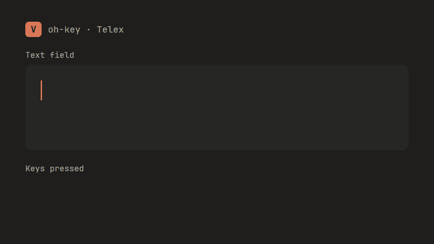
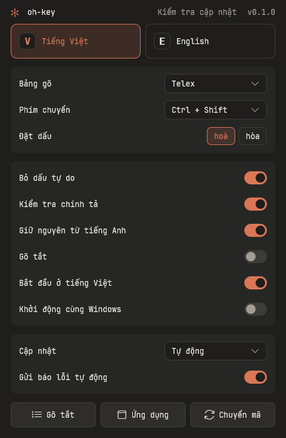
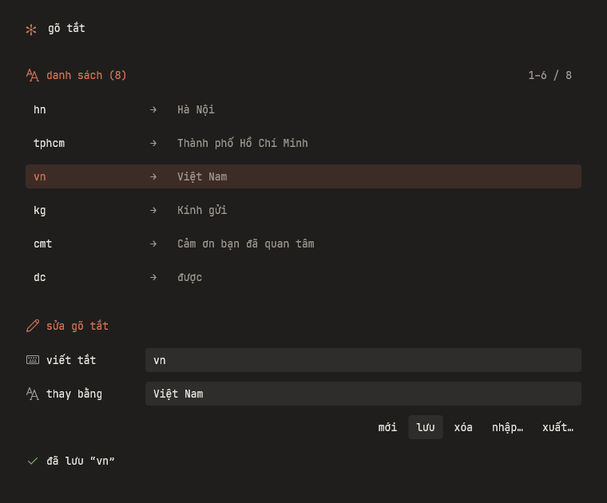
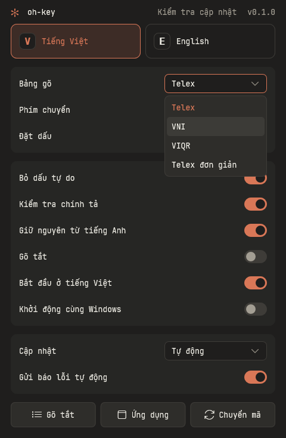
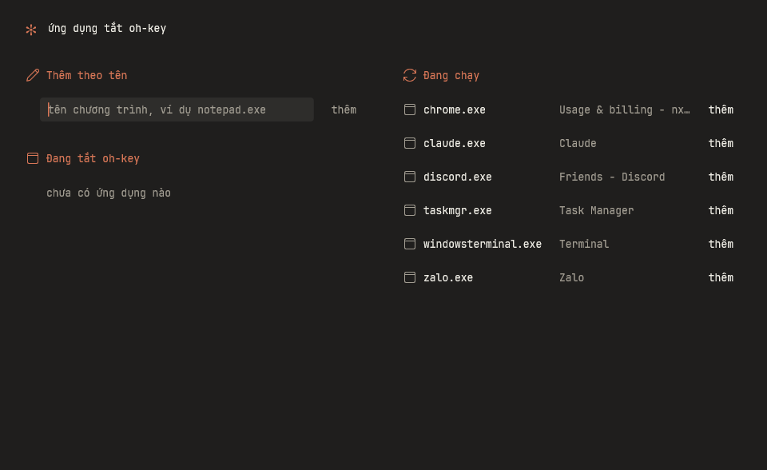

<p align="center">
  <a href="https://codepawl.com">
    <picture>
      <source media="(prefers-color-scheme: dark)" srcset="https://raw.githubusercontent.com/codepawl/.github/main/brand/codepawl-lockup-dark.png">
      
    </picture>
  </a>
</p>

<h1 align="center">oh-key</h1>

A Vietnamese typing app written in Rust, in the Unikey style: fast, small and with fewer bugs. It runs on Windows as a tray app and on macOS as an input method and on Linux as an IBus engine.

Bộ gõ tiếng Việt viết bằng Rust: nhanh, nhẹ, ít lỗi hơn Unikey.



Every frame shows the real engine output for the keys typed so far. Note that `deadline`, `project`, `check` and `email` stay English while `Hôm` and `nhé` get their marks. The [MP4 version](docs/media/typing.mp4) is sharper. The script that draws it is in `tools/demo`.



## Status

Early. The engine, charset conversion and the Windows app are in place. The macOS input method builds and passes its bundle checks, but it has not been tried in real apps yet. Do not rely on either for daily typing.

## Install

Download it from [ohkey.codepawl.com](https://ohkey.codepawl.com), which always offers the latest release for your system.

### Windows

Run `oh-key-setup.exe` (in every release after 0.1.0): one installer for x64, x86 and arm64, per user, no administrator rights. Or run this in PowerShell:

```powershell
irm https://ohkey.codepawl.com/install.ps1 | iex
```

The script downloads the latest release for your processor (x64, x86 or arm64) and checks its SHA-256. It copies `oh-key.exe` to `%LOCALAPPDATA%\Programs\oh-key` and starts the app. No administrator rights are needed. From then on the app starts at every sign-in; turn off "Khởi động cùng Windows" in its panel to stop that. `oh-key-cli.exe` is in the release zip.

You can also download `oh-key-windows-<arch>.zip` from the [latest release](https://github.com/codepawl/oh-key-releases/releases/latest) and unzip it anywhere.

### macOS

The build is signed ad hoc and not notarized.

1. Download `oh-key-macos.zip` from the latest release, or run `macos/build.sh`.
2. Unzip it and copy `oh-key.app` to `~/Library/Input Methods`.
3. Run `xattr -dr com.apple.quarantine "$HOME/Library/Input Methods/oh-key.app"`. Gatekeeper blocks a browser download without this step. A local build has no quarantine flag.
4. Log out and in.
5. Open System Settings > Keyboard > Input Sources and add oh-key under Vietnamese.

Settings live in `~/Library/Application Support/oh-key/config.toml`, the same format as on Windows. The mode switches with Ctrl+Shift or Option+Z.

### Linux (IBus)

Cài đặt trên Linux (IBus, mặc định của GNOME; cũng chạy trên KDE và các môi trường khác qua IBus):

1. Tải `oh-key-linux-x86_64.tar.gz` hoặc `oh-key_<phiên bản>_amd64.deb` từ [bản phát hành mới nhất](https://github.com/codepawl/oh-key-releases/releases/latest).
2. Bản `.deb`: `sudo apt install ./oh-key_<phiên bản>_amd64.deb`. Bản tar: `tar xzf oh-key-linux-x86_64.tar.gz && cd oh-key-linux-x86_64 && sudo ./install.sh`.
3. Chạy `ibus restart`.
4. Mở Settings > Keyboard > Input Sources, thêm Vietnamese (oh-key).

Cấu hình nằm ở `$XDG_CONFIG_HOME/oh-key/config.toml` (mặc định `~/.config/oh-key/config.toml`) và `macros.txt` cùng thư mục, cùng định dạng như trên Windows. Sửa file là có hiệu lực ở lần chuyển ô nhập kế tiếp, không cần khởi động lại. Bật/tắt tiếng Việt bằng Ctrl+Shift hoặc Alt+Z (theo `toggle_hotkey`), hoặc phím chuyển nguồn nhập của IBus (Super+Space). Gỡ cài đặt: `sudo apt remove oh-key` hoặc `sudo ./uninstall.sh`.

Install on Linux (IBus, the GNOME default; it also works on KDE and other desktops through IBus):

1. Download `oh-key-linux-x86_64.tar.gz` or `oh-key_<version>_amd64.deb` from the [latest release](https://github.com/codepawl/oh-key-releases/releases/latest).
2. For the `.deb`: `sudo apt install ./oh-key_<version>_amd64.deb`. For the tarball: `tar xzf oh-key-linux-x86_64.tar.gz && cd oh-key-linux-x86_64 && sudo ./install.sh`.
3. Run `ibus restart`.
4. Open Settings > Keyboard > Input Sources and add Vietnamese (oh-key).

Settings live in `$XDG_CONFIG_HOME/oh-key/config.toml` (default `~/.config/oh-key/config.toml`) with `macros.txt` beside it, the same format as on Windows. An edited file applies the next time a text field gets focus. Ctrl+Shift or Alt+Z (the `toggle_hotkey` setting) switches Vietnamese and English, as does IBus's own input source switch (Super+Space). Uninstall with `sudo apt remove oh-key` or `sudo ./uninstall.sh`. To build it yourself, install `libibus-1.0-dev` and `pkg-config`, then run `bash linux/package.sh`. The word being typed sits in the underlined preedit, so it works in GTK, Qt, browsers and terminals; the excluded apps list does not apply because IBus does not tell the engine which program has focus.

## Numbers

Speed and correctness come from one machine: Intel i7-14700KF, 64 GB DDR4-3600, Windows 11, release builds. The machine was busy during the runs, so each speed figure is the median of 5 runs, with the range in brackets. Full tables, commands and the list of wrong words are in [docs/benchmarks.md](docs/benchmarks.md).

| What | oh-key | UniKey | Source |
| --- | --- | --- | --- |
| Median ns per key, 300,035-key Vietnamese Telex corpus | 44.59 (43.77 to 74.70) | 35.82 (35.27 to 43.62) | `bench/unikey-compare/run.ps1` |
| Median ns per key, 303,588-key mixed English and Vietnamese corpus | 34.80 (34.33 to 36.00) | 33.77 (33.45 to 35.23) | `bench/unikey-compare/run-mixed.ps1` |
| Wrong words in 51,140 words of Vietnamese prose | 0 | 179 | `bench/unikey-compare/run.ps1` |
| Program size | 834,560 bytes | not measured | `tools/measure-footprint.ps1` |

Both ran on 2026-11-12. oh-key takes 24% more time per key on the Vietnamese corpus (1.24x) and 3% more on the mixed corpus (1.03x). Both are far below one microsecond per key, so neither is noticeable while typing. The probable cause is that oh-key returns a `String` per committed word. This is inferred and has not been profiled. The engine had a 2-3x speed-up in commit `85e49ea`.

The 179 UniKey errors are English words with a doubled key: `pass` becomes `pas`, `boss` becomes `bos` and `coffee` becomes `cofee`.

### Footprint and latency

Measured on the Windows release build. The sources, dates and scripts are in [docs/benchmarks.md](docs/benchmarks.md#footprint).

| What | Value | Source |
| --- | --- | --- |
| Installed copy, hook on, 2026-11-12: working set | 7.31 MB | `tools/measure-footprint.ps1` |
| Same: private bytes, threads, handles | 3.32 MB, 2, 205 | `tools/measure-footprint.ps1` |
| Same: CPU time over 30 seconds (includes the keys typed meanwhile) | 93.8 ms | `tools/measure-footprint.ps1` |
| Trim work, hook off: idle working set, before to after | 21.7 MB to 3.6 MB | `tools/measure-trim.ps1` |
| Trim work: context switches per 60 seconds idle, before to after | 876 to 0 | `tools/measure-trim.ps1` |
| Trim work: working set with the settings window closed again, before to after | 49.9 MB to 6.6 MB | `tools/measure-trim.ps1` |
| Time in the hook callback, p50 / p99 / max (CI run 43195361798, 2,938 keys, includes `SendInput`) | 0 to 1 us / 170 to 201 us / 466 us | `hook_suite` |

The hook latency is from a hosted CI runner, not from this machine.

### English words typed with Telex on

This is the case that matters when you write English inside Vietnamese. The test types 303,588 keys over seven token categories. A token is wrong when the output differs from the English word that was typed. Both engines read some English words as valid Vietnamese (`best` becomes `bét`, `see` becomes `sê`), and nothing can tell them apart without a dictionary.

| Category | oh-key wrong | UniKey wrong | oh-key distinct | UniKey distinct |
| --- | ---: | ---: | ---: | ---: |
| English words that collide with Telex keys | 1508 | 2480 | 29 | 92 |
| English words that are also Telex Vietnamese | 1976 | 2072 | 38 | 44 |
| Brands and proper nouns | 104 | 447 | 2 | 27 |
| Code and tech tokens | 364 | 467 | 7 | 16 |
| Mixed Vietnamese and English sentences | 208 | 728 | 4 | 13 |
| All caps and capitalised English | 260 | 878 | 5 | 35 |
| English followed by punctuation | 728 | 1114 | 14 | 24 |

"Distinct" counts each typed token once. oh-key is wrong on fewer distinct tokens in every category. One token is wrong in oh-key and right in UniKey: `#ff00aa` becomes `#ff00â`. The open items are listed in the benchmark report.

### Tests

- The workspace has 218 tests. All pass.
- The hook suite has 34 cases. It replays headless inside `cargo test` and runs for real on Windows in CI (`hook-e2e`).
- An adversarial engine test builds 13,833 syllables and types them in Telex, VNI and several key orders.
- Engine changes need a typing test: keys in, text out.
- The mixed English and Vietnamese corpus has its own tests in `crates/oh-key-engine/tests/english_mixed.rs`.

## Features

- **Input methods:** Telex, VNI, VIQR and simple Telex.
- **Tone style:** classic (`hòa`) or modern (`hoà`) placement.
- **Spell check and restore:** if the keys make no Vietnamese word, oh-key gives back the exact keys you typed. Examples are `window` and `github`. A word list covers English words with doubled keys.
- **Macros** (gõ tắt, Windows only): an editor for abbreviations in Unikey's macro file format, with import and export.
- **Charset converter** (chuyển mã, Windows only): converts the clipboard between Unicode, TCVN3, VNI, VIQR and other charsets.
- **Excluded apps** (ứng dụng tắt oh-key): programs on the list keep their keys untouched.
- **Hotkeys:** Ctrl+Shift or Alt+Z switches V and E on Windows. They work in every app, also in English mode.
- **Tray icon and settings window (Windows only):** the icon shows V or E. A left click switches the mode and a right click opens the menu.
- **Mode switch sound and effect (Windows only):** a soft two-note sound, rising for V and falling for E. A V or E tile pops up by the caret and letters fly off it. Each has its own switch in the settings. Both also show over full-screen apps; a Direct3D game in exclusive full screen gets the sound only, Windows presentation mode gets neither, and the effect follows the Windows "Animation effects" switch.
- **macOS:** the same engine, `macros.txt`, the excluded apps list, the hotkeys (Ctrl+Shift or Option+Z) and an input source menu. The macOS build has been built and bundle-checked on a Mac, but not tried in real apps. CI builds it.






## How it works

On Windows, oh-key installs a low-level keyboard hook (`WH_KEYBOARD_LL`). It sees each key before the application, runs it through the typing engine and sends the change back with `SendInput`. The hook reads every key you type, so you have to trust the program. oh-key never stores, logs or sends the keys, and the code is here to check.

The method is the same as Unikey's, with the same limits. An app that handles fast backspaces badly can still show a wrong letter. A window that runs as administrator is out of reach, and oh-key leaves it alone. A few games with anti-cheat refuse hooks. Put such programs on the excluded apps list.

What oh-key does to cut Unikey's backspace bugs:

- **Only the changed tail is rewritten.** A tone or a hat key sends the fewest backspaces. It adds the new tail and does not retype the whole word.
- **One batch per key.** The backspaces and the new characters leave in one `SendInput` call. The next key cannot land in the middle of the edit.
- **Unicode events, not key codes.** The result does not depend on the keyboard layout of the target app.
- **Its own output is never read back.** Every key oh-key sends carries a marker, and the hook skips it.
- **No allocation per key.** The engine allocates one `String` per committed word. `crates/oh-key-engine/examples/bench.rs` is the benchmark.

On macOS, an InputMethodKit controller written in Swift (`macos/`) calls the same engine through a C API in `crates/oh-key-ffi`. It replaces the changed tail of the word with `insertText`. If a field gives no cursor position, it falls back to marked text.

| Crate | Purpose |
| --- | --- |
| `oh-key-engine` | Telex, VNI and VIQR engine, spell check, restore |
| `oh-key-charset` | Charset conversion |
| `oh-key-macro` | Macro expansion |
| `oh-key-ipc` | Settings format and shared state |
| `oh-key-app` | Windows tray app and keyboard hook |
| `oh-key-ffi` | C API for the macOS frontend |
| `oh-key-ibus` | Key handling of the Linux IBus engine (C glue in `linux/ibus`) |
| `oh-key-cli` | `oh-key-cli type <keys>` shows what the engine makes of a key sequence |

## Build

You need a current stable Rust toolchain. On Windows build for the MSVC target.

```powershell
cargo build --release --target x86_64-pc-windows-msvc
cargo test --workspace --target x86_64-pc-windows-msvc
```

On a Mac, `macos/build.sh` builds the universal app and zips it. `macos/verify.sh` checks the bundle.

Before a pull request, run these checks:

```powershell
cargo fmt --check
cargo check-all
cargo test-all
```

To redraw the demo, run `uv run --no-project python tools/demo/make_demo.py`. It needs Chrome and ffmpeg.

## Roadmap

- Try the macOS input method in real apps.
- Try the Linux IBus engine in real desktops; an fcitx5 addon.

## Licence

GPL-3.0-or-later. See [LICENSE](LICENSE). Parts follow the behaviour of Unikey, which is GPL as well. The credit to its author is in [NOTICE](NOTICE).

<br>

<p align="center">
  <sub>Made by CodePawl, an independent 3D studio in Vietnam.</sub>
  <br>
  <sub>
    <a href="https://codepawl.com">Website</a> ·
    <a href="https://x.com/codepawl">X</a> ·
    <a href="https://github.com/codepawl">GitHub</a> ·
    <a href="https://huggingface.co/codepawl">Hugging Face</a> ·
    <a href="https://www.youtube.com/@codepawlhq">YouTube</a> ·
    <a href="https://www.threads.com/@codepawl">Threads</a>
  </sub>
</p>
