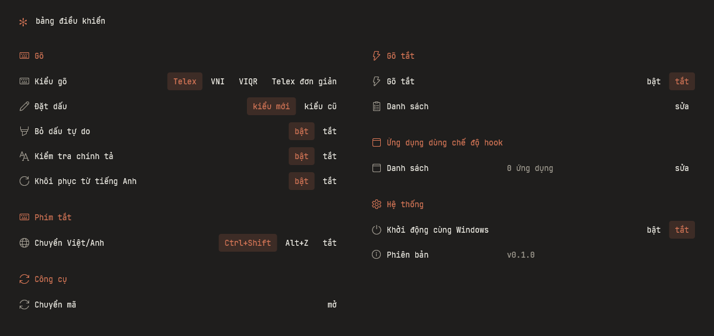
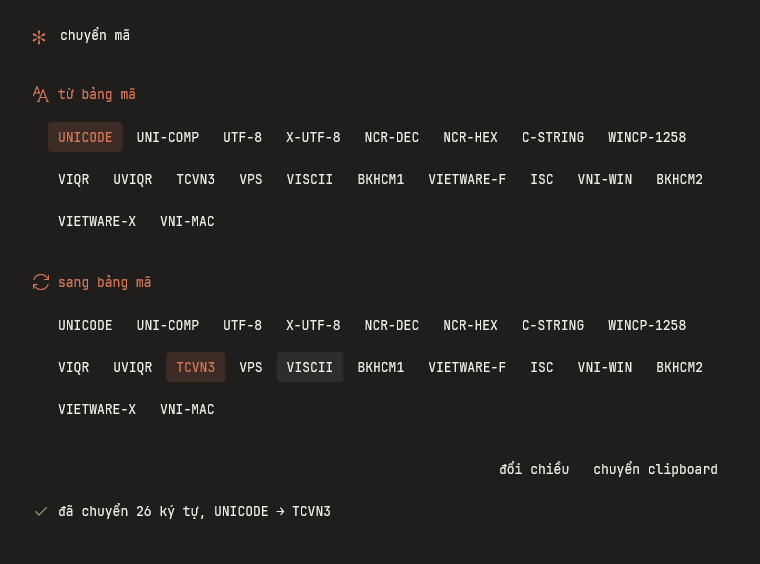

# oh-key

A Vietnamese typing app for Windows written in Rust, in the Unikey style: fast, small and with fewer bugs.

Bộ gõ tiếng Việt viết bằng Rust: nhanh, nhẹ, ít lỗi hơn Unikey.



## How it works

oh-key is a tray app that types Vietnamese in every Windows app, like Unikey. To do that it installs a low-level keyboard hook (`WH_KEYBOARD_LL`): it sees each key before the application does, runs it through the typing engine and, when the word changes, sends the change back with `SendInput`. It reads the keys you type in every app, so it is a program you have to trust; it never stores, logs or sends them anywhere, and the code is here to check.

This is the same basic method as Unikey, and it has the same limits: an app that handles fast backspaces badly can still show a wrong letter, a window that runs as administrator is out of reach (oh-key leaves it alone), and a few games with anti-cheat refuse hooks. Put such programs on the "Ứng dụng tắt oh-key" list in the control panel.

What oh-key does to cut Unikey's backspace bugs:

- **Only the changed tail is rewritten.** Letters that need no change go through untouched, and a tone or a hat key sends the fewest backspaces plus the new tail, not the whole word.
- **One batch per key.** The backspaces and the new characters leave in a single `SendInput` call, so a key you type next cannot land in the middle of the edit. Unikey's doubled and lost letters come from that gap.
- **Unicode events, not key codes.** The new text is sent as Unicode characters, so it does not depend on the target app's keyboard layout.
- **Its own output is never read back.** Every key oh-key sends carries a marker, and the hook skips it.
- **Spell check and restore.** If the keys do not make a Vietnamese word (for example `window` or `github`), oh-key gives back the exact keys you typed.
- **Speed.** The engine avoids allocation on the typing path and has a benchmark (`crates/oh-key-engine/examples/bench.rs`).
- **Ported from Unikey where it was right.** Charsets (Unicode, TCVN3, VNI, VIQR and others), macros and typing rules follow Unikey's behaviour, with tests for each.

## The app

`oh-key.exe` sits in the tray and shows the mode, V for Vietnamese and E for English. A left click switches the mode, a right click opens the menu. The control panel changes the input method (Telex, VNI, VIQR, simple Telex), tone placement, spell check, restore, the switch hotkey (Ctrl+Shift or Alt+Z), macros and start with Windows. The hotkey works in every app, also in English mode.

- **Macros** (gõ tắt): an editor for abbreviations in Unikey's macro file format, with import and export.
- **Charset converter** (chuyển mã): converts the clipboard between Unicode, TCVN3, VNI, VIQR and the other charsets.
- **Apps where oh-key is off** (ứng dụng tắt oh-key): programs you list keep their keys untouched.




## Status

Early. The engine, charset conversion and the app are in place; do not rely on it for daily typing yet.

## Install (Windows)

While the repository is private, install needs the [GitHub CLI](https://cli.github.com) signed in:

```powershell
gh auth login
gh repo clone codepawl/oh-key
.\oh-key\install.ps1
```

`install.ps1` downloads the latest release for your processor (x64, x86 or arm64), checks its SHA-256, copies `oh-key.exe` and `oh-key-cli.exe` to `%LOCALAPPDATA%\Programs\oh-key` and starts the app. No administrator rights are needed. Add `-StartAtSignIn` to start the app every time you sign in.

`oh-key-cli type <keys>` shows what the engine makes of a key sequence.

## Build

You need a current stable Rust toolchain. On Windows build for the MSVC target.

```powershell
cargo build --release --target x86_64-pc-windows-msvc
cargo test --workspace --target x86_64-pc-windows-msvc
```

## Roadmap

- macOS frontend with InputMethodKit (IMK).
- Linux frontends for fcitx5 and ibus.


## Licence

GPL-3.0-or-later. See [LICENSE](LICENSE). Parts follow the behaviour of Unikey, which is GPL as well.
